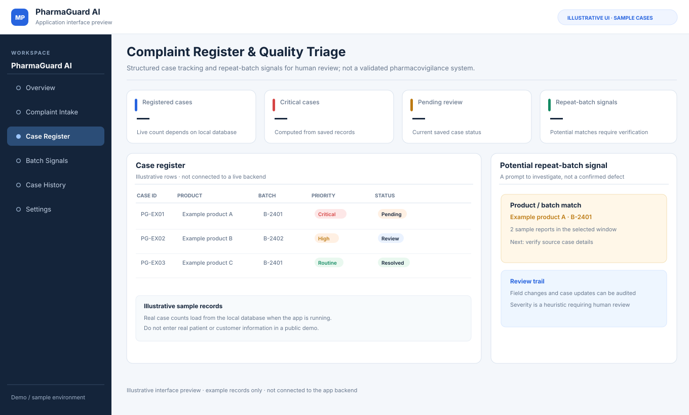

# PharmaGuard AI — Complaint Intake & Quality Triage

PharmaGuard AI is a prototype for collecting pharmaceutical product complaints, extracting structured details from chat/PDF input, applying transparent rule-based severity heuristics, and helping a quality team organise cases for follow-up.

## Interface Preview (Illustrative)

> Illustrative interface preview with example records. It is not connected to a live backend and does not represent a validated pharmacovigilance workflow.

It uses an LLM to assist with extraction, but a deterministic keyword rule currently assigns the final severity. It is a learning project, not a validated pharmacovigilance system or a replacement for approved safety-reporting procedures.

## Problem addressed

When complaints arrive through chat messages and PDF forms, details such as product, strength, batch number and description can be inconsistent. Teams need a structured case record and a way to notice potentially related complaints without treating an automated signal as proof.

## Core workflow

1. Receive complaint details through the chat interface or extract text from a complaint PDF.
2. Use the LLM to propose structured fields while preserving the conversation's existing case ID when the user corrects information.
3. Apply the existing deterministic keyword severity rules and show the reason/action with the result.
4. Save sufficiently complete complaints into a local SQLite case register.
5. Append a create/update event when a case is created or its stored fields change.
6. Group recent reports with the same normalised product name and batch number into **potential repeat-batch signals** for human review.
7. Show live dashboard counts, a saved-case table, and the repeat-batch signals in the React UI.

## Improvements in this version

- **Persistent case register:** complaint records survive backend restarts instead of living only in process memory.
- **Stable case IDs:** later edits to the same conversation update the existing complaint record instead of silently creating a second ID.
- **Case event history:** create/update actions are recorded with changed field names and a UTC timestamp.
- **Potential repeated-batch detection:** two or more reports for the same product/batch in a configurable recent window appear in a review list. Critical-case counts help reviewers choose what to inspect first.
- **Live dashboard metrics:** Total, Critical, Pending and Resolved cards are computed from saved records; they are not hard-coded sample numbers.
- **Review API:** list, inspect and retrieve events for saved complaints; query product/batch signals through dedicated endpoints.
- **Focused automated tests and CI:** SQLite persistence, same-ID edits, batch grouping, summary counts and validation are covered by pytest.

## Safety and interpretation

- A repeated product/batch signal is **not** a confirmed quality defect, adverse reaction, or causal link. It is a prompt to verify product/batch identity and inspect source cases under approved procedures.
- Severity classification remains a simple keyword heuristic. It can miss serious cases, flag context incorrectly, or misunderstand negation. It should not be used as the sole decision-maker for patient safety or regulatory reporting.
- The prototype does not validate complaint information against an authoritative product master, lot-release system, or external safety database.
- There is no authentication or role-based access control in the demo. Do not expose it to the public internet or put real patient/customer identifiers into an untrusted deployment.
- The case store is local SQLite by default at `backend/data/complaints.sqlite3`. Set `PHARMAGUARD_DB_PATH` to choose another path. The database file is runtime data and should not be committed.

## Technology

- **Frontend:** React, Vite
- **API:** FastAPI
- **AI workflow:** LangGraph, Groq API, Llama 3.1 8B Instant
- **PDF text extraction:** PyMuPDF
- **Persistence:** Python `sqlite3`
- **Tests:** pytest and GitHub Actions

## Running locally

### Backend

From the `backend/app` directory (adjust to your existing environment and installed packages):

    uvicorn main:app --reload

Set `GROQ_API_KEY` in your local environment before starting the backend. The first complete complaint initialises the database automatically; the API startup also creates its tables.

### Frontend

From `frontend/`:

    npm install
    npm run dev

The frontend expects the backend at `http://127.0.0.1:8000` in this development configuration.

### Test the persistence layer

From the repository root:

    python -m pip install pytest
    python -m pytest backend/tests/test_case_store.py -q

## API endpoints added

- `GET /complaints?limit=50` — list recent saved cases; supports `severity`, `status` and `batch_number` filters.
- `GET /complaints/{complaint_id}` — fetch one saved case.
- `GET /complaints/{complaint_id}/events` — retrieve create/update event history.
- `GET /analytics/summary` — return live dashboard counts.
- `GET /analytics/batch-signals?days=30&min_reports=2` — find repeated product/batch reports in the selected window.

## Why I built it

I wanted to demonstrate more than an AI chat interface: structured extraction, persistent records, traceable edits, deterministic rule-based triage, and a simple signal that helps a human reviewer notice repeated reports. The design keeps automated prompts separate from the final quality/safety decision.

## Existing limitations and next steps

The local demo still uses one shared in-memory conversation context, has no authentication/multi-user session isolation, and stores files in a local upload directory. Before any real operational use, it would need controlled access, retention/deletion policy, secure file handling, stronger validation, status-transition controls, database migration/backup, reviewed severity rules, and validation by qualified quality/pharmacovigilance professionals.
