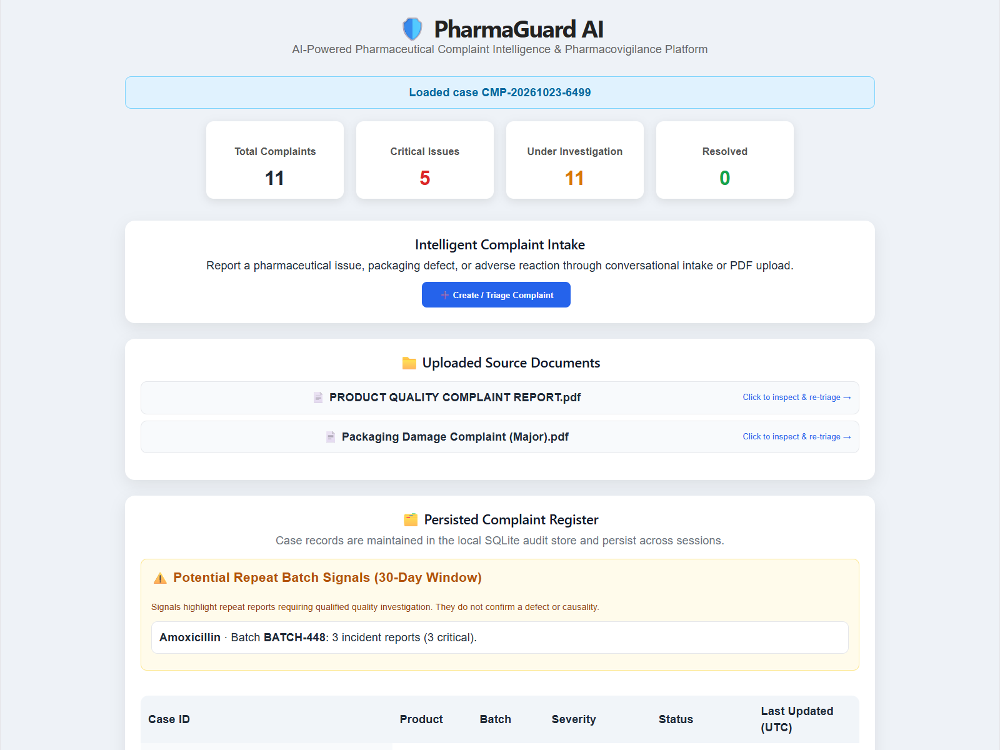

# PharmaGuard AI — Complaint Intake, Security Hardening & Quality Triage

PharmaGuard AI is an automated platform for collecting pharmaceutical product quality and adverse event complaints, extracting structured clinical and batch details from text or PDF source reports, executing transparent deterministic severity triage, and maintaining a durable audit register with repeat-batch signal detection.

## Live Runtime Interface



> Genuine runtime capture of PharmaGuard AI showing live KPI metrics, active repeat-batch alert signals, SQLite complaint register, and automated triage intelligence report.

---

## Key Capabilities & Production Hardening

### 1. Robust File Upload & Storage Security
- **Strict Size Limits:** 10MB maximum payload restriction on uploaded PDFs.
- **Header & Magic Byte Verification:** Verifies true binary `%PDF-` signature before file handling, blocking disguised executable payloads.
- **Path Traversal Protection:** All filesystem routes (`/upload`, `/files/{filename}`, `/extract/{filename}`) sanitize filenames and enforce strict `Path.resolve().is_relative_to(UPLOAD_DIR)` boundary checks.
- **Filename Sanitization:** Strips directory separators, null bytes, and malicious characters.

### 2. Resilient API & Conversational Triage
- **Graceful LLM Degradation:** If Groq API credentials are unset or the external LLM is unreachable, the system automatically falls back to deterministic regex pattern matchers and keyword classification, guaranteeing zero downtime.
- **Session Isolation & Reset:** Multi-session support via `session_id` in `ChatRequest` and a dedicated `POST /chat/reset` endpoint to clear conversation state cleanly.
- **Deterministic Clinical Severity Heuristics:** Keyword-based classification categorizes incidents into **Critical**, **Major**, or **Minor** with specific risk levels and recommended QA actions.

### 3. Auditable Persistence & Signal Intelligence
- **Durable SQLite Register:** All triaged cases persist in `backend/data/complaints.sqlite3` across restarts.
- **Append-Only Event Ledger:** Every case creation and field modification appends an immutable event log with changed field keys and UTC timestamps.
- **Repeat-Batch Signal Detection:** Automated aggregation flags product and batch combinations with 2+ incident reports within a configurable 30-day window, surfacing high-risk quality patterns for human QA investigation.

---

## System Architecture

```
User Input (Chat / PDF Upload)
       │
       ▼
FastAPI Gateway ───► Security Checks (Magic bytes, 10MB limit, Path validation)
       │
       ▼
LangGraph Agent Engine ───► Intent Classifier (Complaint vs Chat)
       │
       ├──► Groq LLM (Llama 3.1 8B) or Deterministic Extraction Fallback
       │
       ▼
Deterministic Severity Engine ───► [Critical / Major / Minor]
       │
       ▼
SQLite Case Store & Audit Ledger ──► Repeat-Batch Pattern Detector
       │
       ▼
React (Vite) UI ──► Live KPI Cards, Audited Register, Intelligence Reports
```

---

## Technology Stack

- **Frontend:** React 19, Vite
- **API & Gateway:** FastAPI, Uvicorn, Pydantic
- **AI & Workflow Orchestration:** LangGraph, Groq API (Llama 3.1 8B Instant)
- **PDF Extraction:** PyMuPDF (`pymupdf`)
- **Database & Audit:** SQLite3 with WAL mode and foreign key constraints
- **Test Suite:** pytest, httpx, Playwright, GitHub Actions CI

---

## Local Development & Setup

### 1. Backend Setup

```bash
# From repository root
pip install -r requirements.txt

# Start FastAPI backend (port 8000)
cd backend/app
uvicorn main:app --reload --port 8000
```

> **Note:** If `GROQ_API_KEY` is not present in `.env`, the backend operates in deterministic fallback mode with full triage capability.

### 2. Frontend Setup

```bash
cd frontend
npm install
npm run dev
```

The frontend will run at `http://localhost:5173` and connect to `http://127.0.0.1:8000`.

### 3. Running Automated Tests

Run the full automated test suite covering SQLite persistence, upload security, path traversal rejection, chat fallback, and analytics endpoints:

```bash
pytest backend/tests -v
```

---

## API Endpoints

| Method | Endpoint | Description |
|---|---|---|
| `GET` | `/` | Service health status and version |
| `POST` | `/upload` | Secure PDF upload with 10MB limit and magic byte checks |
| `GET` | `/files` | List uploaded complaint documents |
| `GET` | `/files/{filename}` | Securely retrieve uploaded PDF |
| `GET` | `/extract/{filename}` | Extract text from PDF document |
| `POST` | `/chat` | Conversational intake and structured case extraction |
| `POST` | `/chat/reset` | Reset conversational memory for session |
| `GET` | `/complaints` | Filterable complaint case register |
| `GET` | `/complaints/{id}` | Detailed case inspection |
| `GET` | `/complaints/{id}/events` | Immutable case audit log |
| `GET` | `/analytics/summary` | Live KPI metrics (total, critical, pending, resolved) |
| `GET` | `/analytics/batch-signals` | 30-day repeat-batch review signals |

---

## Quality & Regulatory Notice

PharmaGuard AI is designed as an operational prototype and decision-support system. In compliance with pharmacovigilance standards (e.g. FDA 21 CFR Part 11 / GAMP 5), repeat-batch alerts highlight potential trends for qualified human quality review and do not assert confirmed product defects or clinical causality.
